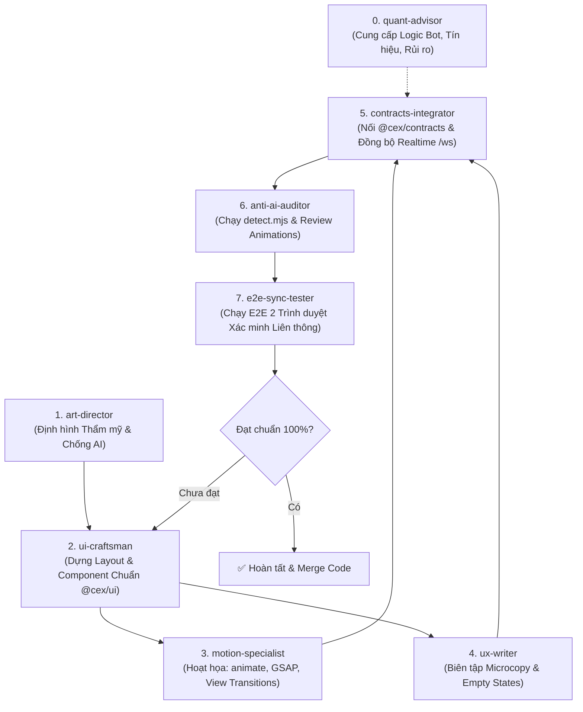

# HỆ THỐNG AGENTS & SKILLS THIẾT KẾ, LIÊN THÔNG VÀ BOT ĐỊNH LƯỢNG ANTIGRAVITY

Chào mừng bạn đến với không gian làm việc `D:\Claude\crypto\ui`. Tại đây, Antigravity vận hành một đội ngũ 8 subagents chuyên biệt hóa theo mô hình Xưởng thiết kế kết hợp Kỹ thuật hệ thống & Cố vấn Định lượng (High-Craft Design, Systems & Quant Studio), đảm bảo 3 tiêu chuẩn cốt lõi:
1. **Thẩm mỹ Độc bản & Chống AI Slop:** Tinh tế, hiện đại, xóa bỏ hoàn toàn các lỗi thiết kế rập khuôn của AI.
2. **Liên thông Hoàn hảo giữa Web Admin và Web Sàn (Exchange):** Vận hành mượt mà theo kiến trúc của Claude Code (`docs/antigravity/PROMPT-08-web-admin-noi-web-san.md`), đồng bộ dữ liệu thời gian thực (Realtime WebSocket) và vượt qua kiểm thử Playwright hai trình duyệt.
3. **Logic Bot Giao dịch & Cố vấn Đầu tư Định lượng (Quant Logic):** Phân tích chế độ thị trường, quản trị rủi ro, chống overfitting, tính toán vị thế khoa học.

---

## 1. Danh sách 8 Subagents Chuyên biệt & Vai trò Đảm nhiệm

| Subagent | Chức danh | Kỹ năng (Skill) chính | Trọng tâm công việc |
| :--- | :--- | :--- | :--- |
| **`art-director`** | Art Director & Aesthetic Lead | `avoid-ai-design` `frontend-design` `premium-web-design` | Định hướng thẩm mỹ, moodboard, phối màu chủ đạo, phân cấp font chữ, tiêu chuẩn Apple-tier, tiêu diệt các khuôn mẫu AI sáo rỗng. |
| **`ui-craftsman`** | UI Component Architect | `impeccable` (craft-floor, layout) `vercel-composition-patterns` `animate` `apple-design` | Xây dựng layout, component chuẩn React 19, nhịp điệu khoảng cách, responsive từ 360px mobile, cấu trúc spring physics, chống lồng thẻ. |
| **`motion-specialist`** | Motion & Interaction Specialist | `animate` `review-animations` `animation-performance` `motion-design` `gsap-react` `gsap-scrolltrigger` `apple-design` `vercel-react-view-transitions` | Thiết kế chuyển động vi mô 60/120fps, React View Transitions mượt mà, Disney principles cho UI, GSAP React 19, phản hồi tương tác chân thực, chống hiệu ứng rác mắt. |
| **`ux-writer`** | UX Copywriter & Content Designer | `impeccable` (clarify, onboard) Quy chuẩn ngữ cảnh sản phẩm | Biên tập microcopy súc tích, CTA hành động dứt khoát, thiết kế trạng thái lỗi và màn hình trống thân thiện. |
| **`anti-ai-auditor`** | Anti-AI QA & Code Auditor | `avoid-ai-design` (detect.mjs) `impeccable` (audit, critique) `review-animations` `animation-performance` | Chạy scanner tự động dò tìm lỗi AI tells, kiểm tra tương phản màu (WCAG), rà soát layout thrashing, chống frame-drop trước khi xuất bản. |
| **`contracts-integrator`** | Contracts Integrator & Realtime Architect | `packages/contracts` `orderbook-ui-states` `decimal-money-safety` | Nối chuẩn client API, đồng bộ realtime WebSocket `/ws` giữa Admin và Sàn; tuyệt đối không tự tính số dư ở frontend. |
| **`e2e-sync-tester`** | E2E Sync Tester & Dual-Browser QA | Playwright E2E Tests `e2e/tests/admin.spec.ts` | Gắn chuẩn `data-testid`, kiểm thử thao tác song song trên 2 trình duyệt: Admin bấm nút → Web sàn cập nhật ngay không reload. |
| **`quant-advisor`** | Quant Strategist & Bot Advisor | `trading-strategy-review` `crypto-regime-analyzer` `risk-management` `position-sizing` | Thẩm định chiến lược bot, nhận diện trạng thái thị trường, định cỡ vị thế, cố vấn đầu tư có cơ sở khoa học (anti-overfitting). |

---

## 2. Thư viện Skills Đã Tích Hợp (`.agent/skills/`)

### A. Nhóm Thiết kế & Anti-AI (UI Craft & Quality Floor)
1. **`avoid-ai-design`**: Scanner tĩnh `scripts/detect.mjs` phát hiện code-level AI tells, danh mục lỗi rập khuôn AI Cấp 1 & Cấp 2.
2. **`impeccable`**: Động cơ thiết kế toàn diện với hơn 40 playbooks (`craft-floor.md`, `polish.md`, `typeset.md`, `layout.md`, v.v.).
3. **`frontend-design`**: Nguyên lý thiết kế lấy cảm hứng từ thế giới thực của sàn giao dịch tài chính.
4. **`premium-web-design`**: Hệ thống thiết kế Apple/Stripe-tier, cấu trúc design tokens, phân cấp thị giác theo nghiên cứu khoa học (50ms rule) và animation cookbook.
5. **`vercel-composition-patterns`**: Kiến trúc compound components, giải phóng boolean props.
6. **`vercel-react-best-practices`**: Hơn 60 quy tắc tối ưu hiệu năng render và bundle size.

### B. Nhóm Hoạt họa & Chuyển động Vi mô (Animation & Motion Craft)
7. **`animate`**: Xây dựng animation chuẩn từ đầu theo triết lý Emil Kowalski; quy tắc chọn công cụ rẻ nhất (CSS `@starting-style`, WAAPI, Motion), chỉ dùng `transform`/`opacity`, cấm `scale(0)`, công thức easing & duration chuẩn xác kèm thư viện `RECIPES.md`.
8. **`review-animations`**: Bộ tiêu chuẩn review và audit animation nghiêm ngặt (`STANDARDS.md`), phát hiện layout-thrashing (`width`/`height`/`top`/`left`), bắt buộc `prefers-reduced-motion`.
9. **`animation-performance`**: Hướng dẫn tối ưu chuyển động 60fps/120fps, loại bỏ giật lag (frame drop), kiểm soát `will-change`, layer promotion và GPU compositor layers.
10. **`motion-design`**: Hệ thống nguyên lý chuyển động phổ quát từ LottieFiles; chuyển hóa 12 nguyên lý Disney vào UI phản ứng nhanh, cấu trúc 3 lớp chuyển động (Primary, Secondary, Ambient), bảng timing & easing và vũ đạo đa phần tử (choreography).
11. **`apple-design`**: Triết lý thiết kế giao diện vật lý chất lỏng (fluid interface) của Apple (WWDC); chuyển động quán tính (momentum), spring có thể ngắt tức thì (interruptible), hiệu ứng chiều sâu và vật liệu xuyên thấu.
12. **`gsap-react`**: Chuẩn chính thức từ GreenSock cho React 19 và Next.js; hook `useGSAP()`, scoped selector, tự động dọn dẹp animation tránh memory leak và context-safe callbacks.
13. **`gsap-scrolltrigger`**: Kỹ thuật hoạt họa theo hành vi cuộn trang chuyên nghiệp, scrub timeline, pinned header/chart mượt mà.
14. **`vercel-react-view-transitions`**: Hướng dẫn React View Transitions native mượt mà giữa các trang và trạng thái.

### C. Nhóm An toàn Dữ liệu & Trạng thái Sàn (Exchange States & Safety)
15. **`orderbook-ui-states`**: Chuẩn hóa 9 trạng thái giao dịch (`LOADING`, `LIVE`, `EMPTY`, `ERROR`, `STALE`, `UNAVAILABLE`, `DISCONNECTED`, `RECONNECTING`, `BLOCKED`).
16. **`decimal-money-safety`**: Xử lý an toàn chuỗi số thập phân (string decimal), cấm tự tính toán làm sai lệch số dư.
17. **`realtime-market-data-qa`**: Đảm bảo luồng dữ liệu thị trường WebSocket không bị lag hay hiển thị giá cũ.

### D. Nhóm Định lượng & Bot Giao dịch (Quant Engine & Advisory)
18. **`trading-strategy-review`**: Đánh giá chiến lược, PBO (Probability of Backtest Overfitting), Deflated Sharpe ratio.
19. **`crypto-regime-analyzer`**: Phân loại chế độ thị trường crypto (Trending, Ranging, High/Low Volatility).
20. **`risk-management`**: Quản trị rủi ro phá sản (Risk-of-Ruin), max drawdown, stop-loss động.
21. **`position-sizing`**: Tính toán quy mô vị thế theo tỷ lệ Kelly và biến động giá thực tế.
22. **`custom-indicators`**: Thiết kế chỉ báo kỹ thuật đặc thù cho bot và tín hiệu.

---

## 3. Quy trình Phối hợp Khép kín

---

## 4. Cách Kích hoạt Agent trong Antigravity

Antigravity có thể kích hoạt các agent này bất cứ lúc nào qua `invoke_subagent`:
* Khi cần làm giao diện & hoạt họa: triệu hồi nhóm UI (`art-director`, `ui-craftsman`, `motion-specialist`, `ux-writer`, `anti-ai-auditor`).
* Khi cần liên thông Admin ↔ Sàn: triệu hồi `contracts-integrator` và `e2e-sync-tester`.
* Khi cần thuật toán bot hoặc cố vấn đầu tư: triệu hồi `quant-advisor`.
