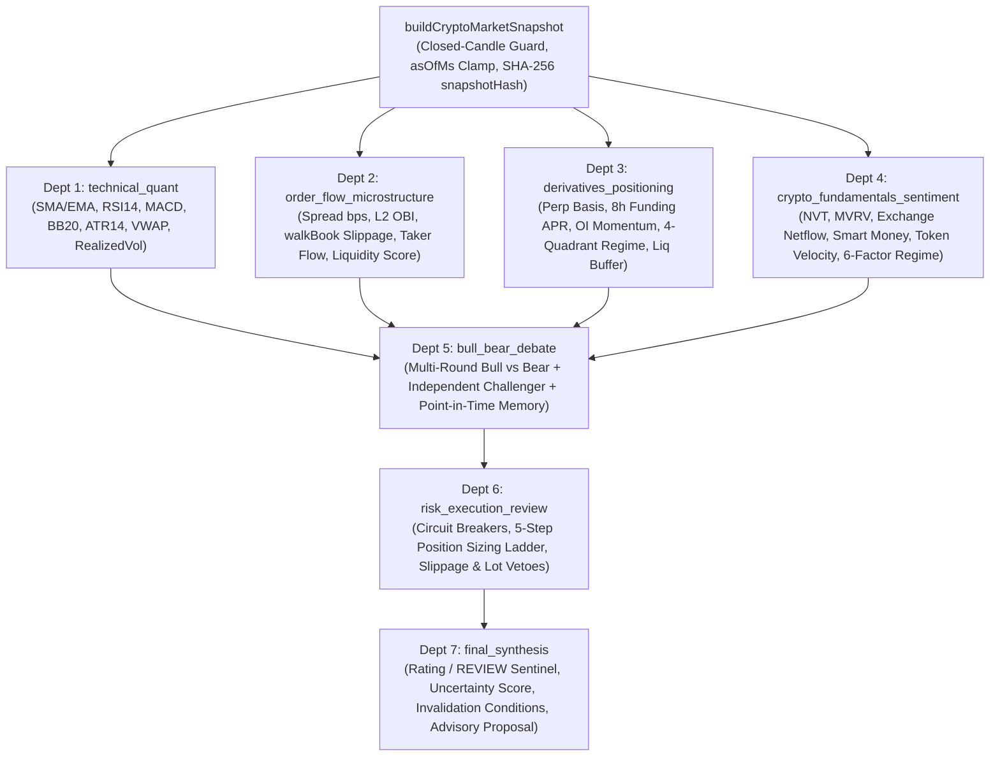

# Crypto-Native Multi-Agent Market Analysis Subsystem (`@cex/core` + `@cex/contracts` + `server/src/modules/analysis`)

## 1. Upstream Repository & Pinned Revision

| Property | Value |
| :--- | :--- |
| **Upstream Repository** | `https://github.com/TauricResearch/TradingAgents` |
| **Local Isolated Clone** | `D:\Claude\crypto\vendor\TradingAgents` (gitignored via `/vendor/` in `.gitignore`) |
| **Default Branch** | `main` |
| **Pinned Commit SHA** | `1394a3f72aa4393e1a98f51b382434c4b4c2d972` (`1394a3f`) |
| **Upstream Release Tag** | `v0.6.0` (2026-04-14) |
| **License** | `Apache-2.0` (`vendor/TradingAgents/LICENSE`) |

---

## 2. License, Security & Dependency Review

- **License Compatibility**: Upstream `TradingAgents` is licensed under **Apache License 2.0**, permitting adaptation, modification, and commercial/private distribution with attribution.
- **Zero External Dependency Bloat**: Upstream is a Python (`>=3.10`) package (`langchain-core`, `langgraph`, `yfinance`, `stockstats`, `feedparser`, `curl_cffi`) that assumes US equity markets and external LLM API keys (`OPENAI_API_KEY`, `ANTHROPIC_API_KEY`, `GOOGLE_API_KEY`). Rather than introducing a secondary Python runtime or paid API dependencies into the Node >= 22 TypeScript CEX monorepo, we ported the reusable multi-agent orchestration and point-in-time safety patterns natively into TypeScript on top of `@cex/core` (`decimal.js` precision 60) and `@cex/contracts` (`zod`).
- **Execution Isolation**: The analysis subsystem is strictly read/advisory (`advisoryOnly: true`, `liveExecutionEnabled: false`). It has **zero** imports of `OrderService.placeOrder` or `applyBalanceChanges` and cannot place live orders, initiate withdrawals, or mutate user balances.

---

## 3. Stock-Oriented Assumptions Replaced for Crypto

| Upstream Stock Assumption (`vendor/TradingAgents`) | Crypto-Native Replacement (`packages/core`, `packages/contracts`, `server/src/modules/analysis`) |
| :--- | :--- |
| Python `float` arithmetic across indicators, portfolio weights, and returns | `@cex/core` `Dec` (`decimal.js`, precision 60) + `DecimalString` contracts; `roundUp` on fees/slippage, `roundDown` on payouts, `floorSigned` on PnL/funding, `floorToStep` on quantities |
| Daily `YYYY-MM-DD` strings and 5/7 business-day calendar math (`settlement.py:69`) | 24/7 UTC `EpochMs` + `IsoDateTime` timestamps across `1m`, `5m`, `15m`, `1h`, `4h`, `1d` closed candles |
| SEC 10-K/10-Q/Form 4 insider filings & P/E ratios (`fundamentals_analyst.py`) | Crypto-native valuation & flow calculators (`nvtRatioDec`, `mvrvRatioDec`, `exchangeNetflowDec`, `smartMoneyFlowDec`, `tokenVelocityDec`) + 6-component Crypto Regime Composite (`computeCryptoRegimeCompositeDec`) |
| No order book microstructure or derivatives funding/OI department | Dedicated **Department 2 (`order_flow_microstructure`)** using `walkBook` slippage (`estimateDepthSlippageDec`), spread bps, L2 OBI, and taker flow, plus **Department 3 (`derivatives_positioning`)** for perp mark-index basis, 8h funding APR, 4-quadrant OI regime, and liquidation buffers |
| Conversational-only risk debate (`aggressive_debator.py`, `conservative_debator.py`) with no mathematical position sizing | Hybrid 3-persona risk committee + deterministic 5-step **Position Sizing Ladder** (`computePositionSizingLadder`) + graduated drawdown/loss-streak circuit breakers (`evaluateCircuitBreakersDec`) |
| Directional-only backtester (`backtest.py:9-15`) with 0 fees, 0 slippage, 0 funding, and `SPY` default benchmark | Point-in-time bar-by-bar walk-forward backtester (`backtester.ts`) filling on `bar[t+1].open` with Spot/Futures fees (`roundUp`), L2 spread + depth slippage, 8h perpetual `fundingPayment`, volume participation caps, Out-of-Sample Walk-Forward folds, Deflated Sharpe Ratio (DSR), and Probability of Backtest Overfitting (PBO) |

### Reusable Upstream Patterns Preserved
1. **Verified Point-in-Time Snapshot (`snapshot.py` #830 + `date_window.py` #1251)**: `buildCryptoMarketSnapshot` freezes authoritative numbers, filters out unclosed bars (`closed !== true`) and future items (`> asOfMs`), and computes a SHA-256 `snapshotHash`.
2. **Explicit Absence Markers (`prompt_fallbacks.py` #1176)**: Missing or disconnected feeds (`derivatives: null`, `onChainAndMacro: null`) emit `DATA_UNAVAILABLE` and `status: 'UNAVAILABLE'` instead of fabricating data.
3. **3-State Portfolio Context & Fingerprint (`portfolio.py`)**: `NOT_PROVIDED` | `FLAT` | `ACTIVE_POSITIONS` with deterministic SHA-256 `fingerprint`.
4. **5-Tier Rating + Non-Tradeable `REVIEW` Sentinel (`rating.py` #1170)**: `BUY`, `OVERWEIGHT`, `HOLD`, `UNDERWEIGHT`, `SELL`, plus `REVIEW` whenever data is `STALE`/`UNAVAILABLE`, core departments fail, or circuit breakers halt trading.

---

## 4. Architecture & Data Flow



---

## 5. Department Responsibilities & Evaluation Criteria

| Department ID | Responsibilities | Permitted `@cex/core` Tools | Inputs | Outputs & Veto Criteria |
| :--- | :--- | :--- | :--- | :--- |
| `technical_quant` | Closed-bar trend, momentum, volatility & mean-reversion | `smaDec`, `emaDec`, `rsiDec`, `macdDec`, `bollingerBandsDec`, `atrDec`, `vwapDec`, `zScoreDec`, `realizedVolatilityPctDec` | `snapshot.spot.closedCandles` (`closed: true`) | `DepartmentFinding`; abstains & blocks if `< 15` closed candles or `spotDataStatus !== 'LIVE'` |
| `order_flow_microstructure` | L2 depth, spread, `walkBook` slippage, aggressor taker flow | `spreadBpsDec`, `orderBookImbalanceDec`, `estimateDepthSlippageDec`, `takerFlowImbalanceDec`, `liquidityScoreDec` | `bids`, `asks`, `recentTrades` | `DepartmentFinding`; raises `BLOCKER` if book is empty, `$25k` walk is unreachable, or spread `> 80` bps |
| `derivatives_positioning` | Perp basis, 8h funding APR, OI momentum, liquidation buffer | `perpBasisBpsDec`, `fundingAnnualizedPctDec`, `openInterestMomentumPctDec`, `classifyOiPriceRegime`, `liquidationBufferBpsDec` | `snapshot.derivatives`, `portfolio.activePositions` | `DepartmentFinding`; emits `UNAVAILABLE` if perp feed is null; raises `BLOCKER` if active position liquidation buffer `< 300` bps |
| `crypto_fundamentals_sentiment` | On-chain valuation, netflows, token velocity, 6-factor regime, headlines | `nvtRatioDec`, `mvrvRatioDec`, `exchangeNetflowDec`, `smartMoneyFlowDec`, `tokenVelocityDec`, `computeCryptoRegimeCompositeDec` | `snapshot.onChainAndMacro` | `DepartmentFinding`; redistributes missing regime weights or returns `UNAVAILABLE` without fabrication |
| `bull_bear_debate` | Multi-round Bull vs. Bear debate + Independent Challenger | Decimal conviction weighting & divergence penalty | Analyst `DepartmentFinding[]`, `PointInTimeMemoryLog` | `BullBearDebateResult`; penalizes cross-department divergence by 25% and adverse memory lessons by 10% |
| `risk_execution_review` | 3-persona risk review + 5-step Position Sizing Ladder + circuit breakers | `computePositionSizingLadder`, `evaluateCircuitBreakersDec`, `estimateDepthSlippageDec`, `checkQuantity`, `checkNotional` | `snapshot`, `analystFindings`, `debate` | `RiskExecutionReview`; vetoes if data is `STALE`/`UNAVAILABLE`, `spotTradeBlock` set, drawdown `>= 15%`, slippage `> 60` bps, or lot check fails |
| `final_synthesis` | Final rating (`BUY`..`SELL` or `REVIEW`), uncertainty, invalidation conditions | Decimal confidence & uncertainty synthesis | All prior outputs | `CryptoMarketAnalysisReport` with `advisoryOnly: true`, `liveExecutionEnabled: false`, and `runSignature` |

---

## 6. Environment Variables & Local Execution Commands

No new API keys, credentials, or external services are required. By default, `ResilientLlmAdapter` uses `DeterministicQuantNarrator` (zero external network calls).

```bash
# 1. Run the standalone CLI demo (single-snapshot analysis + 2-fold walk-forward backtest)
npx tsx server/src/modules/analysis/cli.ts

# 2. Run the unit & integration test suites for @cex/core, @cex/contracts, and server/src/modules/analysis
node infra/test-all.mjs quant.test.ts analysis.test.ts

# 3. Run full workspace typecheck and contract/skill validators
npm run typecheck
node .claude/skills/cex-contract-first-api/scripts/check-contract-drift.mjs
node .claude/skills/cex-skills-maintenance/scripts/validate-skills.mjs
```

---

## 7. Known Limitations & Outstanding Risks

1. **On-Chain & Macro Inputs Optionality**: The CEX simulator's live Binance WebSocket ingestion (`server/src/modules/market/binance.ts`) streams Spot ticker/book/trades/klines and Futures markPrice/fundingRate natively, but does not ingest external on-chain NVT/MVRV or exchange netflow feeds by default. When `onChainAndMacro` is omitted, Department 4 cleanly reports `UNAVAILABLE` and the synthesis layer increases `uncertaintyScore` accordingly.
2. **Open Interest Series Not Ingested by Existing CEX Services**: `BinanceStream` (`server/src/modules/market/binance.ts`) and `FuturesMarkService` (`server/src/modules/futures/markData.ts`) subscribe to `@markPrice@1s` (`markPrice`, `indexPrice`, `fundingRate`, `nextFundingTime`), `@depth20@100ms`, `@aggTrade`, `@ticker`, and `@kline_<interval>`, but do not poll `/fapi/v1/openInterestHist`. `CexMarketDataAdapter` sets `openInterestSeries: []` and documents `fields.openInterest = 'UNAVAILABLE'` rather than fabricating values.
3. **Historical Backtest Book Reconstruction**: When historical L2 orderbook snapshots are not provided per historical bar, `runWalkForwardBacktest` constructs a conservative synthetic top-of-book from bar `spreadBps` and `quoteVolume` and caps trade participation at `maxVolumeParticipation` (default `5%`).
4. **No Profitability Guarantee**: Backtest results, Deflated Sharpe Ratios, and agent confidence scores are strictly research diagnostics and never guarantee live trading profitability.

---

## 8. Phase 2 — Read-Only CEX Market-Data Adapter (`cexMarketAdapter.ts`)

`CexMarketDataAdapter` (`server/src/modules/analysis/cexMarketAdapter.ts`) connects the existing CEX singleton services (`ExchangeConfig`, `MarketDataService`, `CandleService`, optional `DepthSnapshots`, and optional `Futures`) to `buildCryptoMarketSnapshot` and `CryptoTradingAgentsOrchestrator`:

- **Symbol Resolution & Multiplier Scaling**: Normalizes symbol case, checks optional `allowedSymbols`, maps Spot pairs to USDⓈ-M Futures contracts via `resolveFuturesSymbol` / `spotSymbolFor` (`@cex/contracts`), and scales `1000`-multiplier contracts (e.g. `PEPEUSDT` ↔ `1000PEPEUSDT`) by `1 / multiplier` so `markPrice` and `indexPrice` match Spot per-unit pricing.
- **Closed-Candle & Look-Ahead Enforcement**: Strips forming (`closed: false`) candles from both `CandleService.get()` and `MarketDataService.getFormingCandle()`, strips straddling (`openTime <= asOfMs < closeTime`) and future (`> asOfMs`) candles, and withholds future-dated ticker/book/mark/trade observations while downgrading feed freshness from `LIVE` to `STALE`.
- **Zero vs Unavailable Distinction**: Detects `MarketDataService.getTicker()`'s uningested state (`updatedAt === null`) as `UNAVAILABLE` (`null`), while preserving genuine `'0'` / `'0.00000000'` 24h price change and funding rate values.
- **Read-Only Live Smoke Test**:
  ```bash
  node --experimental-transform-types server/src/modules/analysis/smokeRealMarket.ts
  ```

